# AI 图书馆文献检索与阅读助手 — 设计图表集

本文档以 Mermaid 语法提供论文所需的设计图表，可直接在 Typora、VS Code（Markdown Preview Mermaid Support）、
GitHub 或在线编辑器（mermaid.live）中预览与导出为图片。图表内容与当前代码实现一一对应。

- 图 1 系统分层架构图
- 图 2 功能模块图
- 图 3 用例图（学生 / 教师 / 管理员）
- 图 4 ER 图（14 张表）
- 图 5 文献状态流转图
- 图 6 时序图（登录鉴权、混合检索、RAG 问答、文献下载、引用导出、上传审核发布）
- 图 7 活动图（文献索引重建）
- 图 8 部署图

---

## 图 1 系统分层架构图

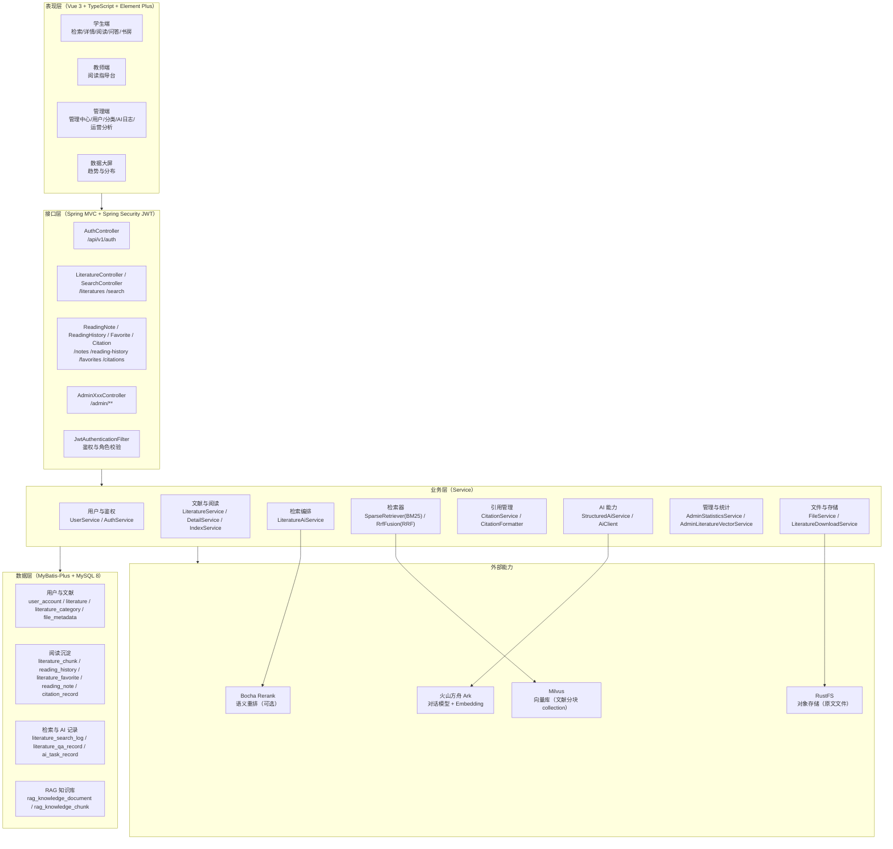

---

## 图 2 功能模块图

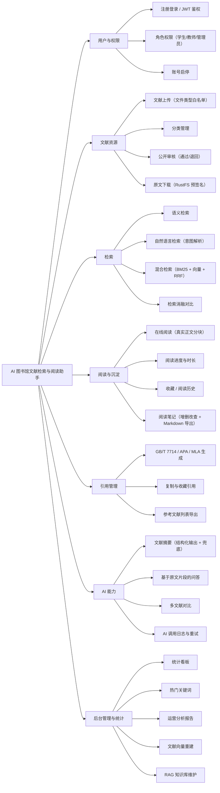

---

## 图 3 用例图

> Mermaid 无原生用例图语法，此处用 flowchart 表达「参与者—用例」关系，语义与 UML 用例图一致。

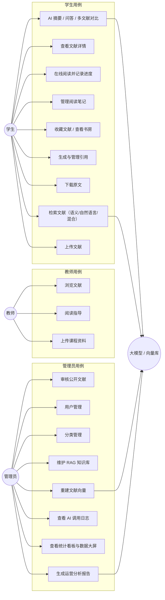

---

## 图 4 ER 图

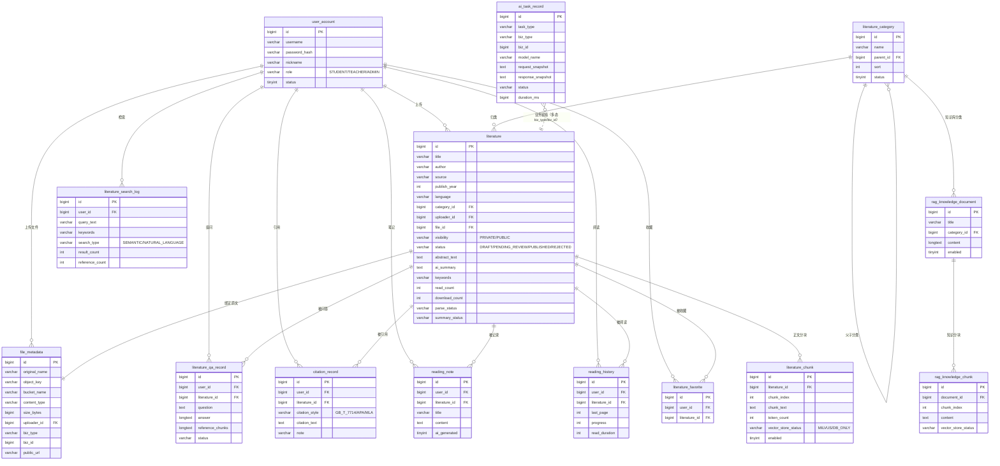

---

## 图 5 文献状态流转图

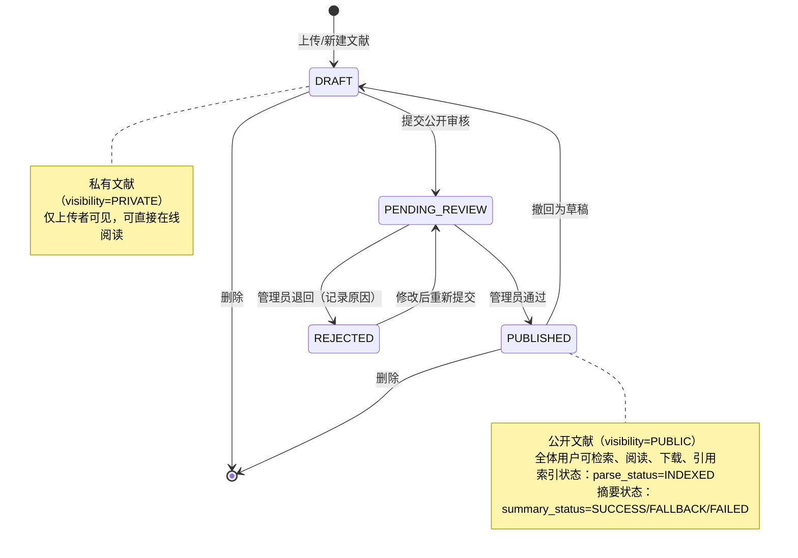

---

## 图 6 时序图

### 6.1 登录与鉴权

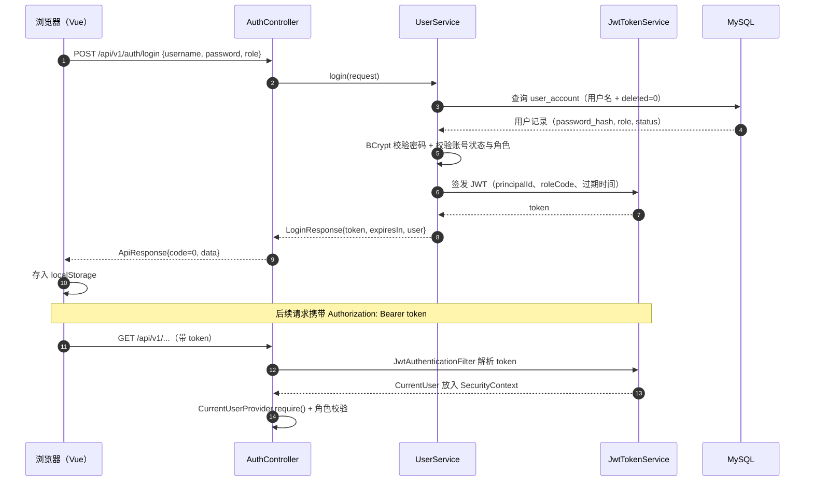

### 6.2 混合检索（BM25 + 向量 + RRF）

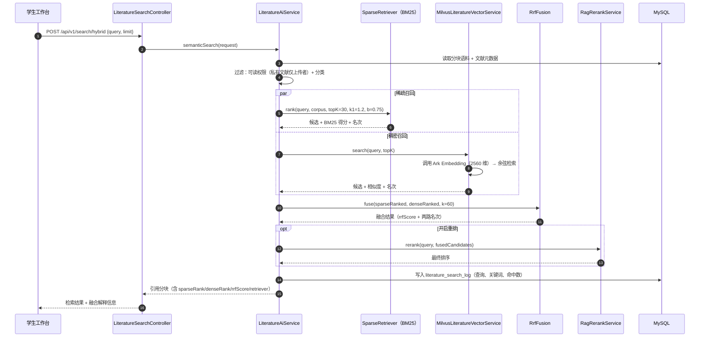

### 6.3 基于原文片段的 AI 问答（RAG）

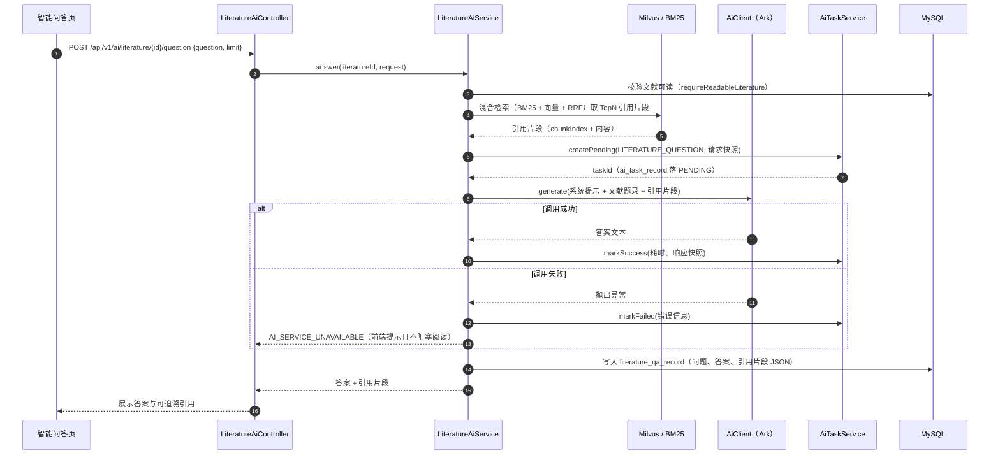

### 6.4 文献下载（RustFS 预签名）

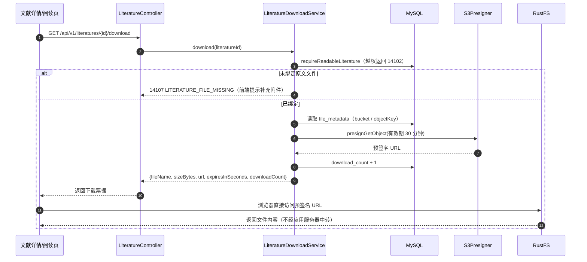

### 6.5 引用生成与参考文献导出

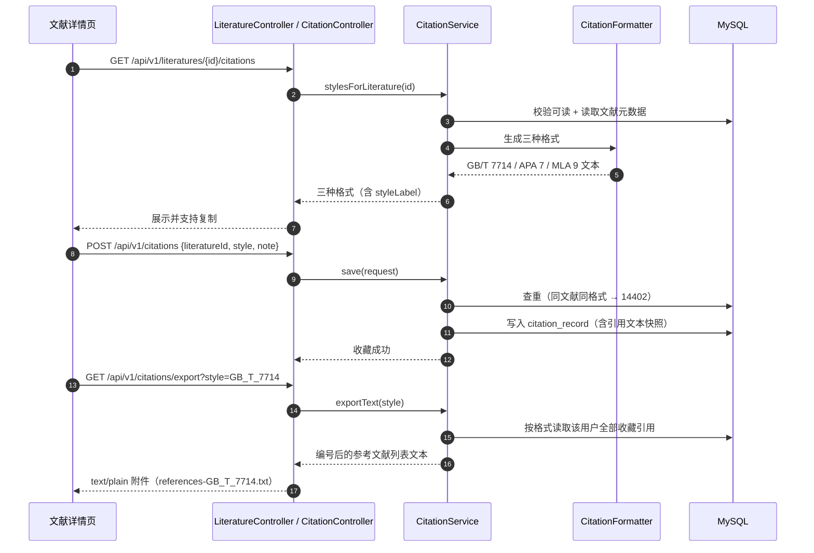

### 6.6 文献上传 → 审核 → 发布 → 索引

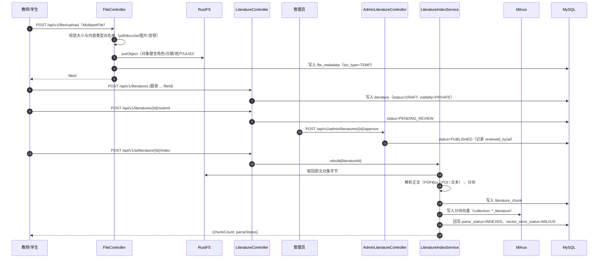

---

## 图 7 活动图：文献索引重建

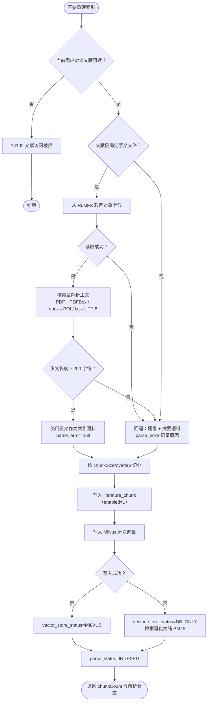

---

## 图 8 部署图

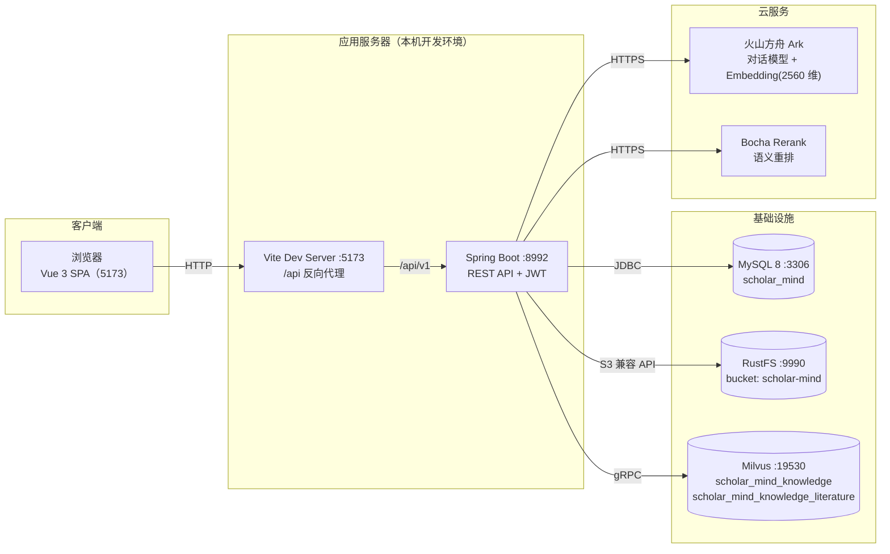

---

## 附：图表与代码对应关系

| 图 | 主要代码位置 |
| --- | --- |
| 图 1 分层架构 | `module/*`（controller/service/mapper）、`common/config/*` |
| 图 3 用例图 | 路由 `ScholarMindWeb/src/router/index.ts` 与各 `views/**` |
| 图 4 ER 图 | `src/main/resources/sql/00~08*.sql` |
| 图 5 状态流转 | `LiteratureService#submit/approve/reject` |
| 图 6.2 混合检索 | `LiteratureAiService#searchChunks`、`SparseRetriever`、`MilvusLiteratureVectorService`、`RrfFusion` |
| 图 6.3 RAG 问答 | `LiteratureAiService#answer`、`StructuredAiService`、`AiTaskService` |
| 图 6.4 下载 | `LiteratureDownloadService` |
| 图 6.5 引用 | `CitationService`、`CitationFormatter` |
| 图 7 索引重建 | `LiteratureIndexService#rebuild`、`LiteratureTextExtractor` |
